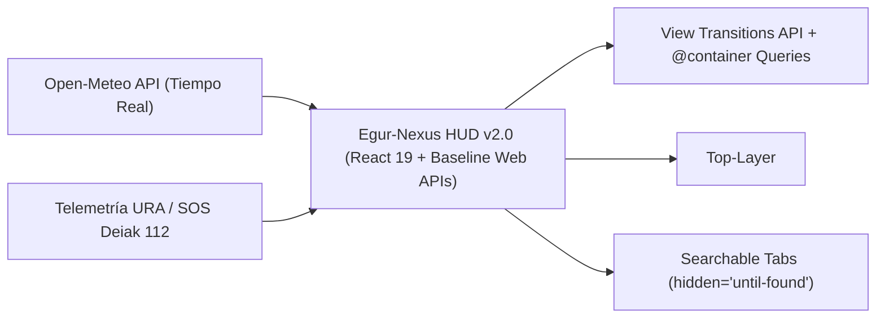

# EGUR-NEXUS v2.0 — Euskadi Environmental & Climate HUD

## 1. Objetivo
**Egur-Nexus** es el sistema integrado de alertas y telemetría ambiental en tiempo real para el País Vasco (Euskadi: Bizkaia, Gipuzkoa y Araba). Monitoriza clima de las tres capitales (Bilbo, Donostia, Gasteiz), mareas y ciclo lunar en el golfo de Bizkaia, índice de riesgo de incendios forestales (FWI), red hidrográfica URA (ríos y embalses) y alertas de protección civil (Euskalmet / SOS Deiak 112).

Rediseñado bajo las directrices de **GoogleChrome Modern Web Guidance (Baseline Web Platform)** con **cero librerías de UI pesadas**.

## 2. Diagrama de Arquitectura y Puertos



- **Puerto Local Asignado (`~/GEMINI.md`):** `3010` (`http://localhost:3010`)
- **Despliegue Público:** [https://txipiron1975.github.io/egur-nexus/](https://txipiron1975.github.io/egur-nexus/)

## 3. Pila Tecnológica y Primitivas Modern Web Guidance
- **Frontend Core:** React 19 + TypeScript + Vite 8 + Lucide Icons.
- **Primitivas Nativas de la Plataforma Web (`modern-web-guidance`):**
  - `light-dismiss-a-dialog` + `animate-to-from-top-layer`: Dossier de emergencia SOS Deiak 112 con `<dialog closedby="any">`, `[popover="auto"]`, `@starting-style`, `transition-behavior: allow-discrete` y `overlay`.
  - `tabs` + `same-document-transitions`: Pestañas con `focusgroup="tablist nomemory"`, bordes con máscaras `@property` animadas por scroll (`animation-timeline: scroll(self inline)`), paneles ocultos mediante `hidden="until-found"` buscables con `Ctrl+F` y `document.startViewTransition()`.
  - `size-aware-styling` + `responsive-table`: Tarjetas de capitales y tabla hidrográfica semántica (`<table>` con cabeceras `sticky`) adaptativas a su propio contenedor (`@container`).
  - `switch` + `design-token-reactivity`: Controles `<input type="checkbox" switch>` y selector de densidad mediante `@container style(--density)`.
  - `customize-scrollbar-color-and-thickness`: Barras de desplazamiento estándar (`scrollbar-width: thin`, `scrollbar-color`) con contraste WCAG ≥ 3:1.

## 4. Puesta en Marcha Paso a Paso (Shell `fish`)

```fish
# Lanzador con ciclo de vida gestionado en CachyOS + Hyprland (Puerto 3010)
fish ~/proyectos_ia/egur_nexus/run_egur_nexus.fish

# Compilación de producción y verificación de linter
cd ~/proyectos_ia/egur_nexus
npm run build
npm run lint
```

## 5. Configuración Segura y Pruebas
- No requiere claves API ni variables `.env` sensibles (consume telemetría pública de Open-Meteo con fallback resiliente offline).
- Auditoría `modern-web-guidance legacy-scan src`: **`0 findings`**.
